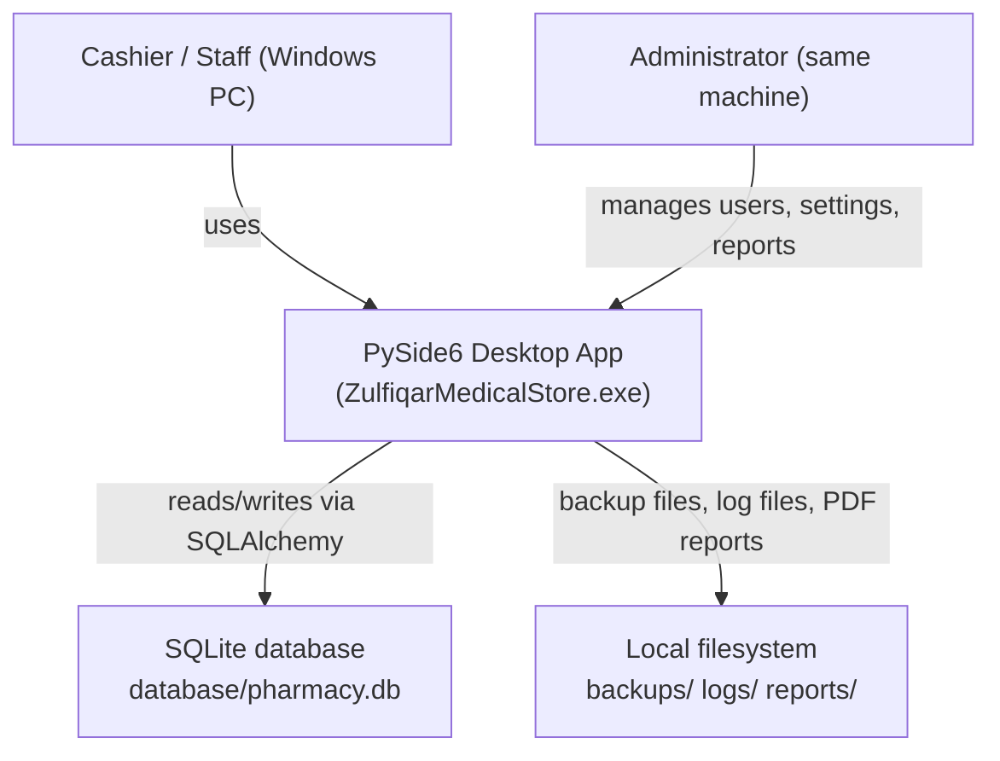
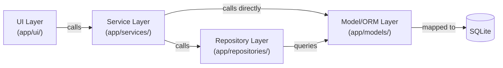
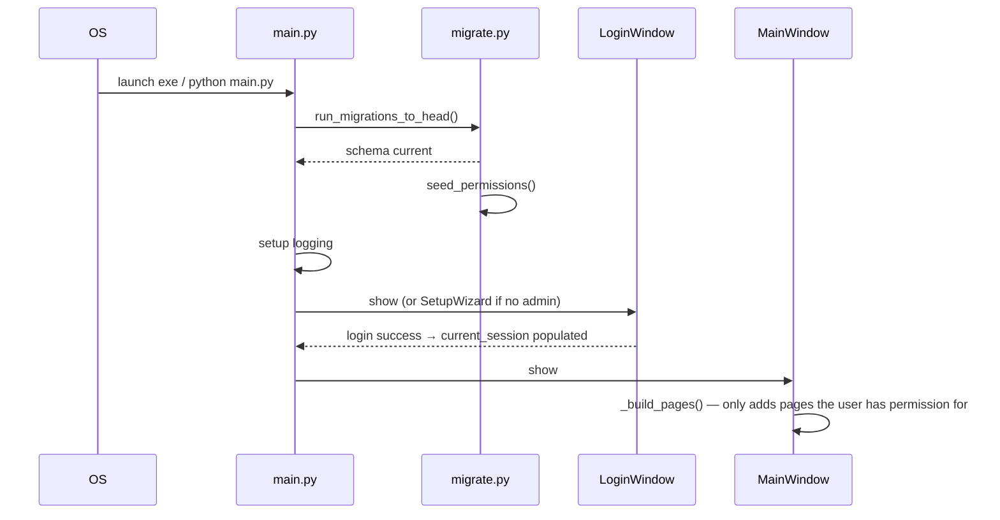
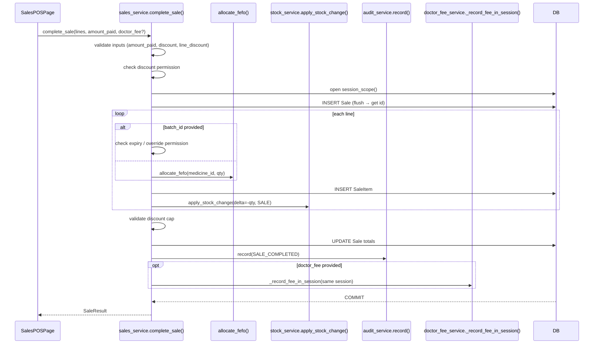

# Architecture.md

**Zulfiqar Medical Store — Pharmacy Management System**
**Scope:** Technical architecture of the production repository as verified on 2026-10-30.
**Evidence basis:** Source code inspection, test runs (105 passed), and migration history. Unverified areas are explicitly marked.

---

## 1. Purpose and Status

An offline-first Windows desktop application for a single-location retail pharmacy. It manages inventory, sales, purchases, returns, expenses, reporting, user access, and backup/restore with no cloud dependency.

Current head migration: `d4e5f6a7b8c9` (doctor_fees table + permissions).
All 105 service-layer tests pass. Four services have no test coverage (see §12).

---

## 2. Technology Stack (Verified)

| Concern | Library | Version floor |
|---|---|---|
| UI framework | PySide6 | ≥ 6.6 |
| ORM | SQLAlchemy | ≥ 2.0 (mapped-column style) |
| Database | SQLite (file-based) | bundled with Python |
| Migrations | Alembic | ≥ 1.13 |
| Password hashing | bcrypt | ≥ 4.1 |
| Excel import/export | pandas + openpyxl | ≥ 2.2 / 3.1 |
| PDF generation | reportlab | ≥ 4.1 |
| Barcode/QR | python-barcode + qrcode + Pillow | various |
| Packaging | PyInstaller | ≥ 6.3 |
| Testing | pytest + pytest-cov | ≥ 8.0 / 4.1 |

---

## 3. System Context



There are no external network calls. All data stays on the local machine.

---

## 4. Module Map

```
app/
  config/
    settings.py         ← AppSettings dataclass; reads env vars; frozen singleton
  database/
    engine.py           ← SQLAlchemy engine (URL from settings)
    session.py          ← session_scope() context manager; init_db()
    migrate.py          ← run_migrations_to_head(); seed_permissions(); startup entry point
  models/
    base.py             ← Base, IDMixin, TimestampMixin
    user.py             ← User, Permission, UserPermission
    audit_log.py        ← AuditLog
    medicine.py         ← Category, Manufacturer, Medicine
    batch.py            ← MedicineBatch
    location.py         ← Wardrobe, Rack, Shelf
    party.py            ← Supplier, Customer
    purchase.py         ← Purchase, PurchaseItem, PurchaseReturn, PurchaseReturnItem
    sale.py             ← Sale, SaleItem, SaleReturn, SaleReturnItem
    stock_transaction.py← StockTransaction
    expense.py          ← ExpenseCategory, Expense
    settings.py         ← ApplicationSetting, ReportSnapshot
    purchase_order.py   ← PurchaseOrder, PurchaseOrderItem, PurchaseOrderReceipt, PurchaseOrderReceiptItem, POStatus
    cashier_shift.py    ← CashierShift, ShiftStatus
    doctor_fee.py       ← DoctorFee
    __init__.py         ← imports all models (Alembic autogenerate target)
  permissions/
    keys.py             ← GRANTABLE_PERMISSIONS, ADMIN_ONLY_PERMISSIONS, ADMIN_ONLY_KEYS
  repositories/
    base.py             ← generic CRUD helpers
    inventory_repository.py ← MedicineBatchRepository, LocationRepository, SupplierRepository
    user_repository.py  ← UserRepository, PermissionRepository, UserPermissionRepository
  security/
    decorators.py       ← @require_permission(key), @require_admin
    passwords.py        ← hash_password(), verify_password() (bcrypt)
    session_context.py  ← SessionContext singleton (current_session)
  services/
    auth_service.py     ← login, logout, create_first_admin, change_own_password
    user_service.py     ← create_user, deactivate_user, reset_password, list_users
    medicine_service.py ← CRUD + batch management + search + expiry/low-stock reports
    purchase_service.py ← record_purchase, mark_purchase_paid, supplier_purchase_history
    sales_service.py    ← complete_sale (FEFO + stock deduction), list_sales, get_sale_detail
    returns_service.py  ← process_sale_return, process_purchase_return, adjust_stock, write_off_expired_batch
    invoice_edit_service.py ← edit_invoice, get_editable_invoice
    stock_service.py    ← apply_stock_change (SINGLE mutation point), reconcile_batch_quantity
    party_service.py    ← add_supplier, add_customer, list_suppliers/customers
    expense_service.py  ← record_expense, list_expenses
    settings_service.py ← get_setting, set_setting
    backup_service.py   ← create_backup, restore_backup, validate_backup_file
    dashboard_service.py← admin_dashboard_kpis()
    audit_service.py    ← record() (always in same session as the action)
    doctor_fee_service.py ← record_doctor_fee, list_doctor_fees, get_doctor_fee_summary, get_daily_fee_collection, correct_doctor_fee, void_doctor_fee
    purchase_order_service.py ← PO lifecycle: create → approve → receive
    shift_service.py    ← open_shift, close_shift, get_shift_summary
    inventory_intelligence_service.py ← reorder suggestions, expiry risk, dead stock, ABC, turnover, get_demand_forecast
  reports/
    report_engine.py    ← sales_and_profit_report, best_selling_medicines, stock_valuation_report, close_month
  imports/
    excel_importer.py   ← bulk medicine import from Excel
  exports/
    data_exporter.py    ← export to Excel
  printing/
    pdf_documents.py    ← render_invoice_pdf, render_report_pdf
  logging/
    setup.py            ← configure file + console logging
  utils/
    exceptions.py       ← ValidationError, NotFoundError, AuthorizationError, AuthenticationError, …
    numbering.py        ← next_invoice_number()
    assets.py           ← asset_path() (dev vs frozen)
  ui/  (PySide6 pages — one QWidget subclass per page)
    main/main_window.py ← MainWindow, sidebar nav, page stack
    login/              ← LoginWindow, ResetPasswordDialog
    setup_wizard/       ← SetupWizardWindow
    dashboard/          ← DashboardPage
    medicines/          ← MedicinesPage
    inventory/          ← InventoryPage, ReorderPage, ExpiryRiskPage, DeadStockPage, AnalyticsPage, ForecastPage
    sales/              ← SalesPOSPage, SalesHistoryPage
    purchases/          ← PurchasesPage
    purchase_orders/    ← PurchaseOrdersPage (Phase 2)
    customers/          ← CustomersPage
    suppliers/          ← SuppliersPage
    expenses/           ← ExpensesPage
    doctor_fees/        ← DoctorFeesPage (2 tabs: Fee Records, Daily Summary)
    reports/            ← ReportsPage
    users/              ← UsersPage
    settings/           ← SettingsPage
    common/             ← MedicineSearchWidget, ExpiryAlertManager
```

---

## 5. Layer Boundaries and Dependency Direction



**Rules (enforced by conventions, not import guards):**
- UI never touches SQLAlchemy sessions or models directly.
- Repositories never call services.
- Services own transaction boundaries via `session_scope()`.
- `stock_service.apply_stock_change()` is the **only** function that mutates `MedicineBatch.quantity` and must always be used.

---

## 6. Startup Sequence



---

## 7. Database and Session Management

- **SQLite WAL mode** is used for better concurrent read performance.
- `session_scope()` is a `@contextmanager`: commits on clean exit, rolls back on any exception, closes the session in `finally`.
- All service methods that write data open exactly one `session_scope()`. Stock changes participate in the caller's session to ensure atomicity.
- `stock_service.apply_stock_change()` is called with the open session — it never opens its own scope.
- The engine URL comes from `PHARMACY_DB_URL` env var (defaults to `database/pharmacy.db`). Tests override this to a temp file before importing any `app.*` module.

---

## 8. Authentication and Authorization

- **Passwords:** bcrypt hashed. Minimum 8 characters enforced in the service layer.
- **Session:** Single process-wide `SessionContext` singleton (`current_session`). Holds `user_id`, `username`, `is_admin`, and the set of granted permission keys. There is no token or cookie.
- **Session timeout:** Configurable via `PHARMACY_SESSION_TIMEOUT_MIN` (default 30 min). `is_expired()` checks idle time; `@require_permission` clears the session and raises `SessionExpiredError` on expiry.
- **Permission checks:** `@require_permission(key)` decorator on every service function. Admins implicitly have all permissions. `ADMIN_ONLY_KEYS` can never be held by non-admin sessions regardless of DB rows.
- **Generic error messages:** Login failures return identical messages for wrong username vs. wrong password (prevents account enumeration).

---

## 9. Stock Ledger Invariant

Every `MedicineBatch.quantity` change must go through `stock_service.apply_stock_change()`. This function:
1. Computes `new_quantity = previous + delta`.
2. Rejects if `new_quantity < 0` (ValidationError — fails fast before DB constraint).
3. Writes a `StockTransaction` row in the same session.

Verified by `test_purchase_creates_new_batch_and_stock` and `test_sale_return_restocks_batch` (direct ledger row checks).

---

## 10. POS Sale Flow



---

## 11. Purchase Flow

`purchase_service.record_purchase()` → validates inputs → creates/upserts `MedicineBatch` → calls `stock_service.apply_stock_change(delta=+qty, PURCHASE)` → creates `PurchaseItem` → commits. Entire multi-line purchase rolls back on any line error (verified by `test_failed_purchase_line_rolls_back_entire_transaction`).

---

## 12. Testing Strategy and Coverage

**Test database:** Temp SQLite file created before any `app.*` import. Wiped after the session.
**Test runner:** `python -m pytest tests/ --ignore=tests/test_ui_smoke.py`
**Result (2026-10-30):** 105 passed, 0 failed.

| Service / Area | Test file | Status |
|---|---|---|
| Auth, users, permissions, sessions | test_auth_and_permissions.py | ✅ Verified |
| ORM schema / constraints | test_database.py | ✅ Verified |
| Medicine CRUD, batch, expiry | test_inventory.py | ✅ Verified |
| Purchases, rollback | test_purchases.py | ✅ Verified |
| POS, FEFO, expired blocking, discount | test_sales.py | ✅ Verified |
| Returns (sale + purchase), adjustments, write-off | test_returns_and_adjustments.py | ✅ Verified |
| Reports, dashboard, backup/restore | test_reports_dashboard_backup.py | ✅ Verified |
| Excel export, PDF, settings | test_exports_printing_settings.py | ✅ Verified |
| Inventory intelligence (38 tests) | test_inventory_intelligence.py | ✅ Verified |
| UI smoke (offscreen) | test_ui_smoke.py | Not in default run (requires display) |
| **doctor_fee_service** | — | ❌ No tests |
| **invoice_edit_service** | — | ❌ No tests |
| **shift_service** | — | ❌ No tests |
| **purchase_order_service** | — | ❌ No tests |

---

## 13. Packaging

PyInstaller `--onedir` build. Output: `dist/ZulfiqarMedicalStore/ZulfiqarMedicalStore.exe`. The `database/migrations/` directory and `assets/` are bundled via `datas` in `pharmacy_management.spec`. The exe runs its own Alembic migration on first launch (`migrate.run_migrations_to_head()`).

---

## 14. Known Limitations

- SQLite is single-writer; only one PC can run the application at a time.
- `softsolz-test` was an extraneous installed pytest plugin that crashed the test runner — it has been removed.
- Doctor fee, invoice edit, cashier shift, and purchase order services have no test coverage.
- `settings.app_version` is hardcoded as `"1.0.0"` in `config/settings.py`; actual deployed version is 2.2.

---

## 15. Proposed Improvements *(Not Current Behavior)*

- Add `test_doctor_fees.py`, `test_invoice_edit.py`, `test_shifts.py`, `test_purchase_orders.py` test files.
- Bump `app_version` to `"2.2"` in `config/settings.py`.
- Add a `pytest.ini` or `pyproject.toml` `[tool.pytest.ini_options]` section to pin `testpaths` and avoid relying on the absence of broken plugins.
- Consider `aiosqlite` or a network-capable DB backend if multi-user access is ever needed.
