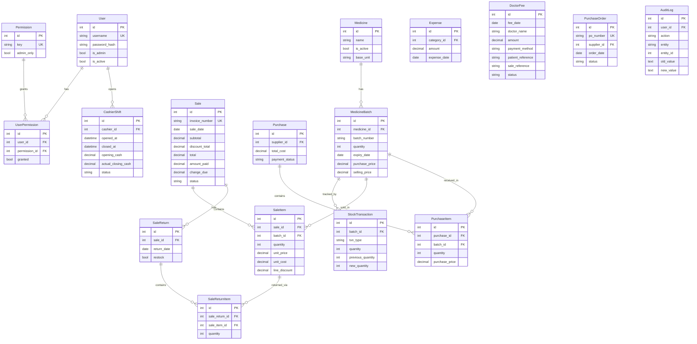

# Design.md

**Zulfiqar Medical Store — Pharmacy Management System**
**Audience:** Product managers, QA engineers, new contributors.
**Evidence basis:** Source code inspection (2026-10-30). Features labeled V (Verified), I (Implemented, not fully tested), or D (Documented only, not verified in code).

---

## 1. User Roles

| Role | Description | Access |
|---|---|---|
| **Administrator** | Full access, manages users, settings, reports, backup | All permissions implicitly |
| **Cashier / Staff** | Handles POS sales and basic inventory | Only explicitly granted `GRANTABLE_PERMISSIONS` keys |

There is no "manager" or "pharmacist" role in the permission model — any non-admin user's access depends entirely on which permission keys the admin grants them.

### 1.1 Permission Keys (Verified — `app/permissions/keys.py`)

**Grantable to non-admins:**
`medicine.view` · `medicine.add` · `medicine.edit` · `medicine.import_excel` · `stock.view` · `stock.adjust` · `stock.intelligence` · `sales.create` · `sales.view` · `sales.discount` · `sales.print_invoice` · `sales.edit_invoice` · `purchases.manage` · `purchase_orders.create` · `purchase_orders.approve` · `purchase_orders.receive` · `shifts.manage` · `customers.manage` · `suppliers.manage` · `reports.view` · `returns.process` · `doctor_fees.view` · `doctor_fees.record` · `doctor_fees.correct`

**Admin-only (never grantable):**
`users.manage` · `settings.manage` · `backup.manage` · `audit_log.view`

---

## 2. Navigation and Pages

All navigation is sidebar-based (`QListWidget` → `QStackedWidget`). Pages are conditionally added at login time based on permissions.

| Sidebar Label | Page | Permission Gate |
|---|---|---|
| Dashboard | DashboardPage | Admin only |
| Medicines | MedicinesPage | `medicine.view` |
| Inventory | InventoryPage | `stock.view` |
| 📦 Reorder Suggestions | ReorderPage | `stock.intelligence` |
| ⚠ Expiry Risk | ExpiryRiskPage | `stock.intelligence` |
| 💤 Dead Stock | DeadStockPage | `stock.intelligence` |
| 📊 Inv. Analytics | InventoryAnalyticsPage | `stock.intelligence` |
| Sales / POS | SalesPOSPage | `sales.create` |
| Sales History | SalesHistoryPage | `sales.view` |
| Purchases | PurchasesPage | `purchases.manage` |
| 📋 Purchase Orders | PurchaseOrdersPage | `purchase_orders.create` |
| Customers | CustomersPage | `customers.manage` |
| Suppliers | SuppliersPage | `suppliers.manage` |
| Expenses | ExpensesPage | `purchases.manage` |
| 👨‍⚕️ Doctor Fees | DoctorFeesPage | `doctor_fees.view` |
| Reports | ReportsPage | `reports.view` |
| Users | UsersPage | Admin only |
| Settings | SettingsPage | Admin only |

---

## 3. Data Model Overview

---

## 4. Key Business Rules (Verified)

### 4.1 FEFO Allocation (V)
Sales use First-Expiry-First-Out. `allocate_fefo()` queries only non-expired, active batches ordered by `expiry_date ASC`. Expired batches are never auto-allocated.

### 4.2 Expired Stock Override (V)
Selling an expired batch requires: (a) explicit `batch_id` in the sale line, (b) `allow_expired_override=True`, (c) `settings.expiry_clearance_override_enabled=True`, and (d) the user holds `sales.override_expired` permission. All four conditions must be true simultaneously.

### 4.3 Discount Rules (V)
- Requires `sales.discount` permission.
- Capped at `settings.max_discount_percent` (default 20%).
- Discount cannot be negative.
- `discount_total` cannot make `total` negative.

### 4.4 Stock Non-Negativity (V)
`stock_service.apply_stock_change()` raises `ValidationError` before allowing `MedicineBatch.quantity` to go negative. Verified by failing rollback test.

### 4.5 Atomic Transactions (V)
`session_scope()` commits on success, rolls back on any exception. A multi-line purchase where one line fails leaves no DB changes. Verified by `test_failed_purchase_line_rolls_back_entire_transaction`.

### 4.6 Doctor Fee Isolation (I — code reviewed, not test-covered)
`DoctorFee` records are stored in a separate table. They do not affect `Sale.total`, stock quantities, or medicine-sales revenue. When a doctor fee is added at POS, it is recorded via `_record_fee_in_session()` inside the same `session_scope()` as the `Sale`, so both commit or both roll back atomically.

### 4.7 Invoice Editing (I — code reviewed, not test-covered)
`invoice_edit_service.edit_invoice()` uses delta-based stock adjustments (`SALE` / `SALE_RETURN` txn types with an invoice reference). Old and new totals are captured in the audit log with the mandatory reason. The action is labeled `INVOICE_EDITED` (not `INVOICE_CORRECTED` as some documentation states — the code uses `INVOICE_EDITED`).

### 4.8 Purchase Order Lifecycle (I)
States: `DRAFT` → `APPROVED` → `PARTIALLY_RECEIVED` → `COMPLETED` / `CANCELLED`. Stock only increases when `receive_goods()` is called (delegates to `purchase_service.record_purchase()`). Cannot cancel a `PARTIALLY_RECEIVED` order.

### 4.9 Report Accuracy (V)
`sales_and_profit_report()` nets out both item-level `line_discount` and sale-level `discount_total`. Returned quantities are subtracted proportionally from revenue and COGS. Cancelled sales are excluded. Verified by `test_reports_dashboard_backup.py`.

### 4.10 Backup/Restore Safety (V)
`restore_backup()` always makes a safety backup of the current DB before restoring, clears WAL/SHM sidecars, and audits the action. Verified by `test_reports_dashboard_backup.py`.

---

## 5. Validation and Error Handling

| Input | Validation | Error type |
|---|---|---|
| Negative `amount_paid` | Rejected | `ValidationError` |
| NaN/infinite numeric inputs | Rejected | `ValidationError` |
| Empty cart | Rejected | `ValidationError` |
| Discount > cap | Rejected | `ValidationError` |
| Expired batch (no override) | Rejected | `ValidationError` |
| Expired override without permission | Rejected | `AuthorizationError` |
| Insufficient stock | Rejected (service layer, not UI pre-check) | `ValidationError` |
| Negative quantity in purchase/return | Rejected | `ValidationError` |
| Missing `reason` for invoice edit/adjustment | Rejected | `ValidationError` |
| Doctor fee amount = 0 | Rejected | `ValidationError` |
| Doctor fee future date | Rejected | `ValidationError` |

UI error display: `ApplicationError` subclasses are caught at the UI boundary and shown as `QMessageBox.critical()`. Stale-stock errors containing "please refresh your cart" show a more specific "Stock Changed" dialog title.

---

## 6. Sales / POS Workflow

1. Cashier searches for a medicine (prefix search or barcode scan).
2. Selects unit type (base unit or pack), sets quantity, clicks "Add to Cart".
3. Cart table shows Medicine, Sale Unit, Qty, Unit Price, DB Avail (live), Est. Total, Remove.
4. (Optional) Enters Doctor Name + Fee amount in the yellow Doctor Fee row.
5. Optionally adjusts Discount field.
6. Amount Paid auto-fills to (subtotal − discount + doctor fee); cashier can override.
7. Clicks "Complete Sale" → `complete_sale()` called → invoice created atomically.
8. Success dialog shows invoice number, medicine total, doctor fee (if any), change due.
9. Optional: Save PDF invoice.

---

## 7. Doctor Fees Workflow

**Via POS (V — code reviewed):** Enter doctor name + fee amount before completing sale. Fee recorded atomically with the sale. `DoctorFee.sale_reference` stores the invoice number.

**Standalone (I):** Doctor Fees page → "Record Fee" button → dialog (date, name, amount, payment method, patient reference, notes). Creates `DoctorFee` with `status=ACTIVE`.

**Correction/Void (I):** "Correct / Void" button per row → dialog requiring mandatory reason. Updates `status` to `CORRECTED` or `VOIDED`. Old/new values in audit log.

**Daily Summary tab (I):** Pick a date → shows total collected, per-doctor breakdown, and all entries for that day.

---

## 8. Implemented Without Full Test Coverage

| Feature | Evidence | Missing |
|---|---|---|
| Doctor fee service | Code reviewed, imports cleanly | Tests for record/list/summary/correct/void |
| Invoice edit service | Code reviewed, imports cleanly | Tests for edit logic, stock delta, audit |
| Cashier shift service | Code reviewed, imports cleanly | Tests for open/close/summary/variance |
| Purchase order service | Code reviewed, imports cleanly | Tests for PO lifecycle |
| Forecast page UI | Code reviewed | UI smoke test doesn't cover ForecastPage |

---

## 9. Known UI Limitations

- No keyboard shortcut to open a "New Purchase" form.
- The ForecastPage's "Initiate Purchase" pre-fills `CreatePODialog` but there is no direct link from the suggestion to an existing purchase record.
- The `_offer_print_invoice()` dialog appears after every completed sale — there is no "always print" setting.
- The Medicines page search is limited to 10,000 results (limit raised from 100 in a prior fix).
- The Setup Wizard "Restore Backup" path is implemented but has no automated test.

---

## 10. Proposed Design Changes *(Not Current Behavior)*

- Add automated tests for the four untested services (see Task.md P0).
- Add a "Forecast" page entry point visible in the sidebar for `stock.intelligence` users (it is already added in `main_window.py` but has no smoke test).
- Add a "Print on Completion" setting to suppress the per-sale print dialog.
- Expose doctor fee totals in the Reports page as a separate revenue line (code in report_engine.py does not yet include doctor fee revenue — see Task.md P1).
